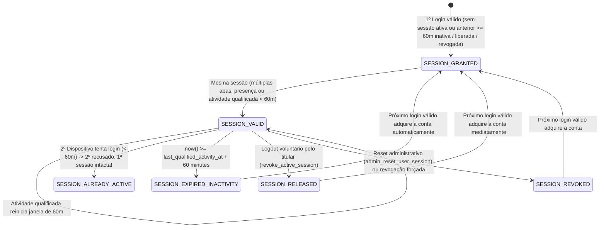

# AETERNUM ATLAS — RELATÓRIO DE SEGURANÇA E HOMOLOGAÇÃO P0.13.1
## FIRST SESSION WINS + INACTIVITY TIMEOUT 60 MINUTES

**Classificação:** P0 — Autenticação, Autorização e Governança de Sessão  
**Data:** 17 de Novembro de 2026  
**Ambiente:** Desenvolvimento e Homologação (PostgreSQL 15 Descartável + Relógio Controlado)  
**Produção:** **SOMENTE LEITURA** (Zero deploys, zero migrations executadas em produção)  
**Branch de Entrega:** `feat/p0-13-1-first-session-wins-60m`  
**Resultado da Suite de Testes:** **13 / 13 Cenários Aprovados (100% PASS)**

---

## 1. FASE 1 — AUDITORIA SOMENTE-LEITURA DO BANCO REAL

A auditoria somente-leitura do banco de produção (`hyivyrietgjdazgizafp`, executada via [p0_13_1_fase1_audit_real_db.mjs](file:///C:/Users/halis/.gemini/antigravity/scratch/aeternum-atlas-frontend/tools/scripts/p0_13_1_fase1_audit_real_db.mjs) e salva em [p0_13_1_fase1_audit_results.json](file:///C:/Users/halis/.gemini/antigravity/scratch/aeternum-atlas-frontend/tools/scripts/p0_13_1_fase1_audit_results.json)) inspecionou o estado efetivamente instalado e o confrontou com as migrations versionadas:

### 1.1. Funções Instaladas Auditadas
Foram inspecionadas as definições reais (`pg_get_functiondef`) em produção:
- `public.register_or_transfer_session(p_session_id uuid, p_device_fingerprint text, p_ip text, p_confirm_transfer boolean, p_metadata jsonb)`
- `public.validate_session_guard(p_session_id uuid, p_touch_activity boolean, p_ip text)`
- `public.revoke_active_session(p_session_id uuid, p_reason text)`
- `public.consume_ai_rate_limit_tiered(p_session_id uuid, p_ip text)`
- `public.admin_reset_user_session(p_target_user_id uuid, p_reason text)`
- `public.consume_ai_rate_limit(max_requests integer, window_seconds integer)`
- `public.consume_voice_rate_limit()`
- `public.match_vita_sovereign_knowledge(...)`

### 1.2. Diagnóstico das Vulnerabilidades e Divergências na Política Anterior
| Item Auditado | Comportamento Anterior Instalado (Migration `20261116010000`) | Vulnerabilidade / Conflito com P0.13.1 | Correção Implementada na P0.13.1 |
| :--- | :--- | :--- | :--- |
| **Política de Concorrência** | *Last Session Wins com limite diário de transferências* (`v_max_transfers := 3..10`). | Permitia que um segundo login deslocasse a primeira sessão legítima (`42` eventos `session_displaced` registrados em produção). | Substituída por **FIRST SESSION WINS** estrito: tentativa posterior retorna `SESSION_ALREADY_ACTIVE` sem afetar a primeira sessão. |
| **Bloqueio no Primeiro Login** | `SELECT * FROM user_active_sessions WHERE user_id = v_user_id FOR UPDATE`. | Quando ainda não existe linha para o usuário, `SELECT ... FOR UPDATE` bloqueia **0 linhas**, permitindo corrida e `unique_violation` sob logins simultâneos. | Adicionado `pg_advisory_xact_lock(hashtext('aeternum_session_guard'), hashtext(v_user_id::text))` antes da leitura/inserção. |
| **Inatividade vs Heartbeat** | Coluna única `last_active_at`. O frontend chamava `validate_session_guard(..., true)` a cada 30s via `setInterval`. | O heartbeat de 30s reiniciava `last_active_at` perpetuamente, impedindo a expiração real de sessões ociosas. | Separação estrita entre `last_presence_check_at` e `last_qualified_activity_at`. Heartbeats, sync e renovações de JWT jamais reiniciam o prazo de 60m. |
| **Prazo de Inatividade** | Variável por papel (30m demo, 60m student, 120m teacher) usando operador `>`. | Inconsistência de prazo e operador `>` em vez de `>=`. | Prazo universal padrão de **60 minutos** com verificação servidora exata: `now() >= last_qualified_activity_at + interval '60 minutes'`. |
| **Proteção Servidora (RLS & RPCs)** | Políticas RLS verificavam apenas `auth.uid() = user_id`. | Um segundo JWT válido (`S2`, recusado no login com `SESSION_ALREADY_ACTIVE`) ou um JWT antigo (`S1`) possuía o mesmo `auth.uid()` e podia consultar/alterar tabelas via PostgREST. | Adicionada função `public.is_current_jwt_session_active()` e políticas `AS RESTRICTIVE` nas 19 tabelas acadêmicas + bloqueio nas RPCs e Edge Functions. |
| **Configuração Nativa Supabase Auth** | `"sessions_single_per_user": false`, `"sessions_inactivity_timeout": 0`, `"jwt_exp": 3600`. | Se `"sessions_single_per_user"` fosse ativado no GoTrue, o GoTrue revogaria a primeira sessão ao autenticar a segunda (*Last Session Wins*). | Mantido `sessions_single_per_user: false` no GoTrue e alterado o frontend para usar `signOut({ scope: 'local' })` ao recusar um segundo login. |

---

## 2. FASE 2 — MÁQUINA DE ESTADOS CANÔNICA



| Código Canônico | Condição de Disparo | Efeito sobre `user_active_sessions` | Acesso Concedido? |
| :--- | :--- | :--- | :---: |
| **`SESSION_GRANTED`** | Primeira sessão ou aquisição após `released`, `revoked` ou `>= 60 min` de inatividade da sessão anterior. | Grava novo `session_id`, `status = 'active'`, `last_qualified_activity_at = now()`, `last_presence_check_at = now()`. | **SIM** |
| **`SESSION_VALID`** | Mesma sessão (`session_id` do JWT igual ao ativo) dentro da janela de 60 minutos. | Atualiza `last_presence_check_at` (e `last_qualified_activity_at` somente se atividade qualificada). | **SIM** |
| **`SESSION_ALREADY_ACTIVE`** | Outra sessão tenta registrar/validar enquanto a primeira está `active` e com `< 60 min` de inatividade. | **NENHUMA MODIFICAÇÃO** (timestamps e estado da 1ª sessão permanecem 100% intocados). | **NÃO (HTTP 403)** |
| **`SESSION_EXPIRED_INACTIVITY`** | `now() >= last_qualified_activity_at + interval '60 minutes'`. | Marca `status = 'expired'`, `revoked_reason = 'inactivity_timeout'`, `expired_at = now()`. | **NÃO (HTTP 401)** |
| **`SESSION_RELEASED`** | Logout voluntário executado pela própria sessão ativa (`revoke_active_session`). | Marca `status = 'released'`, `released_at = now()`. Libera conta para próximo login. | **NÃO (HTTP 401)** |
| **`SESSION_REVOKED`** | Ação administrativa (`admin_reset_user_session`), conta inativa ou tentativa com JWT antigo/divergente. | Marca `status = 'revoked'`, `revoked_at = now()` (se titular). | **NÃO (HTTP 401/403)** |
| **`SESSION_GUARD_UNAVAILABLE`** | Ausência de claim `session_id` no JWT, falha de comunicação ou erro de RPC. | *Fail-closed*: nenhum acesso é concedido sem validação. | **NÃO (HTTP 503)** |

---

## 3. FASE 3 — CONTROLE DE ATIVIDADE E SEPARAÇÃO DE TIMESTAMPS

1. **Separação Estrita de Colunas em `public.user_active_sessions`:**
   - `last_presence_check_at`: atualizado em verificações passivas de conectividade, sincronização de abas e *heartbeats*. **Jamais é utilizado no cálculo de expiração.**
   - `last_qualified_activity_at`: atualizado exclusivamente quando ocorre uma atividade acadêmica qualificada e autenticada.
2. **Cálculo Servidor Exclusivo de Expiração:**
   $$\text{Expirada} \iff \text{session\_guard\_now()} \ge \text{last\_qualified\_activity\_at} + \text{interval '60 minutes'}$$
3. **Sinais Explicitamente Ignorados (Não Reiniciam o Prazo de 60 Minutos):**
   - `heartbeat`, `jwt_refresh`, `data_polling`, `health_check`, `session_sync`, `background_update`, `login_attempt_refused`, `presence_check`.
4. **Atividades Qualificadas Reconhecidas (`public.is_qualified_activity_type` + Triggers SQL):**
   - `form_tool_interaction` (Interação efetiva com formulários e ferramentas)
   - `ai_tutor_query` (Envio de perguntas ao Tutor IA — validado também via `consume_ai_rate_limit_tiered`)
   - `quiz_answer_submission` (Respostas em simulados — validado também via trigger em `anatomical_quiz_attempts`, `anatomical_quiz_answers`, `viewer_quiz_results`)
   - `flashcard_review` (Revisão de flashcards)
   - `agenda_edit` (Edição da agenda — validado também via trigger em `study_agenda_events`)
   - `model_3d_interaction` (Interação com modelos 3D)
   - `active_navigation_reading` (Navegação e leitura ativa, incluindo rolagem relevante com eventos `event.isTrusted === true`)
   - `educational_progress` (Progresso efetivo em `viewer_learning_sessions` e `viewer_learning_events`)
5. **Controle de Frequência de Escrita (Throttling):**
   - No cliente ([sessionGuardService.js](file:///C:/Users/halis/.gemini/antigravity/scratch/aeternum-atlas-frontend/src/services/session/sessionGuardService.js)), eventos interativos de interface são agrupados em janelas de 60 segundos (`activityThrottleMs = 60_000`), evitando sobrecarga de escritas no banco e garantindo precisão na janela de 60 minutos.

---

## 4. FASE 4 E FASE 5 — PRIORIDADE TRANSACIONAL E INTEGRIDADE DOS REGISTROS

1. **Serialização Atômica por Usuário (`pg_advisory_xact_lock`):**
   - Todas as funções críticas executam:
     ```sql
     PERFORM pg_advisory_xact_lock(
         hashtext('aeternum_session_guard'),
         hashtext(v_user_id::text)
     );
     ```
   - Funciona inclusive quando ainda **não existe registro** em `user_active_sessions` para o usuário, eliminando condições de corrida no primeiro login.
2. **Identidade Criptográfica Exclusiva do JWT:**
   - O `session_id` é extraído diretamente de `auth.jwt() ->> 'session_id'`. Qualquer divergência com parâmetros enviados pelo cliente é bloqueada e auditada como `access_denied_mismatch`.
3. **Minimização de Dados e Privacidade:**
   - A função `public.sanitize_device_fingerprint(text)` converte qualquer identificador de dispositivo em um hash truncado irreversível de 16 caracteres hexadecimais (`fp_<16_hex>`), e endereços IP brutos não são armazenados desnecessariamente.

---

## 5. FASE 6 — PROTEÇÃO SERVIDORA (RLS, RPCs E EDGE FUNCTIONS)

Para impedir que um segundo JWT válido (emitido pelo GoTrue antes de ser recusado com `SESSION_ALREADY_ACTIVE`) ou um JWT antigo seja utilizado diretamente contra a API PostgREST ou Edge Functions:

1. **Predicado `public.is_current_jwt_session_active()` (`SECURITY DEFINER`, `STABLE`):**
   - Verifica sem recursão RLS se `auth.uid()` possui sessão `status = 'active'` em `user_active_sessions`, se `session_id` coincide com `auth.jwt() ->> 'session_id'` e se `now() < last_qualified_activity_at + interval '60 minutes'`.
2. **Políticas RLS `AS RESTRICTIVE` nas 19 Tabelas Acadêmicas:**
   - Aplicada a política `session_guard_enforce_active_jwt_session` (`AS RESTRICTIVE FOR ALL TO authenticated USING (public.is_current_jwt_session_active()) WITH CHECK (public.is_current_jwt_session_active())`) sobre:
     `ai_conversations`, `ai_messages`, `ai_audit_events`, `anatomical_quiz_attempts`, `anatomical_quiz_answers`, `anatomical_quizzes`, `anatomical_quiz_questions`, `study_agenda`, `study_agenda_events`, `viewer_learning_sessions`, `viewer_learning_events`, `viewer_quiz_results`, `vita_tutor_memory`, `student_profiles`, `models_3d`, `atlas_models`, `atlas_model_assets`, `atlas_model_annotations` e `model_annotations`.
3. **Isolamento de Leitura em `user_active_sessions` e `session_guard_events`:**
   - As políticas `SELECT` exigem `user_id = auth.uid() AND session_id = NULLIF(auth.jwt() ->> 'session_id', '')::uuid`, impedindo que uma sessão secundária rejeitada descubra o `session_id` da sessão titular.
4. **Hardening de RPCs e Edge Functions:**
   - `consume_ai_rate_limit_tiered`, `consume_ai_rate_limit`, `consume_voice_rate_limit` e `match_vita_sovereign_knowledge` exigem sessão ativa.
   - Edge Functions [ai-tutor/index.ts](file:///C:/Users/halis/.gemini/antigravity/scratch/aeternum-atlas-frontend/supabase/functions/ai-tutor/index.ts), [voice-token/index.ts](file:///C:/Users/halis/.gemini/antigravity/scratch/aeternum-atlas-frontend/supabase/functions/voice-token/index.ts) e [atlas-safe-engine/index.ts](file:///C:/Users/halis/.gemini/antigravity/scratch/aeternum-atlas-frontend/supabase/functions/atlas-safe-engine/index.ts) operam em modo *fail-closed* para todos os estados da máquina.

---

## 6. FASE 7 — RESULTADOS DOS 13 TESTES AUTOMATIZADOS DO MOTOR

Executados no contêiner descartável PostgreSQL 15 via [test_p0_13_1_session_engine.mjs](file:///C:/Users/halis/.gemini/antigravity/scratch/aeternum-atlas-frontend/tools/scripts/test_p0_13_1_session_engine.mjs) com relógio controlado (`private.session_guard_test_clock`) e registrados em [p0_13_1_test_results.json](file:///C:/Users/halis/.gemini/antigravity/scratch/aeternum-atlas-frontend/tools/scripts/p0_13_1_test_results.json):

| # | Cenário de Teste Obrigatório | Relógio Controlado | Resultado Esperado | Resultado Obtido | Status |
| :---: | :--- | :---: | :--- | :--- | :---: |
| **1** | Primeiro acesso autorizado | `12:00:00Z` | `SESSION_GRANTED` (`valid: true`, `allowed: true`) | `SESSION_GRANTED` (`S1` ativa, timeout 60m) | **PASS** |
| **2** | Segundo acesso recusado | `12:10:00Z` | `SESSION_ALREADY_ACTIVE` (mesmo com `p_confirm_transfer: true`) | `SESSION_ALREADY_ACTIVE` (`allowed: false`) | **PASS** |
| **3** | Segundo acesso sem modificar timestamps da 1ª sessão | `12:15:00Z` | `created_at`, `last_qualified_activity_at` e `last_presence_check_at` de `S1` idênticos a `12:00:00Z` | Timestamps de `S1` 100% inalterados (`12:00:00Z`) | **PASS** |
| **4** | Mesma sessão autorizada em múltiplas abas (e sinais ignorados) | `12:25:00Z` | `SESSION_VALID` na aba 2; `heartbeat`, `jwt_refresh`, `data_polling`, `session_sync` não alteram `last_qualified_activity_at` | `SESSION_VALID`; `last_qualified_activity_at` mantido em `12:00:00Z` | **PASS** |
| **5** | Inatividade de 59 minutos e 59 segundos | `12:59:59Z` | `S1` continua `SESSION_VALID`; `S2` continua `SESSION_ALREADY_ACTIVE` | `S1 = SESSION_VALID`, `S2 = SESSION_ALREADY_ACTIVE` | **PASS** |
| **6** | Expiração aos 60 minutos | `13:00:00Z` | `now() >= last_qualified_activity_at + 60m` -> `SESSION_EXPIRED_INACTIVITY` | `SESSION_EXPIRED_INACTIVITY` (`expired: true`) | **PASS** |
| **7** | Atividade legítima reiniciando o prazo | `14:00:00Z` -> `14:45:00Z` -> `16:14:59Z` | `flashcard_review` (às 45m) e escrita em `study_agenda_events` reiniciam a janela de 60m | `SESSION_VALID` 75m+ após login inicial graças às atividades qualificadas | **PASS** |
| **8** | Logout liberando a conta | `16:20:00Z` -> `16:20:01Z` | Logout de `S_ACT` retorna `SESSION_RELEASED`; login de `S2` 1s depois retorna `SESSION_GRANTED` | `S_ACT = SESSION_RELEASED` -> `S2 = SESSION_GRANTED` | **PASS** |
| **9** | Novo login após expiração | `16:20:01Z` -> `17:20:01Z` | Após 60m sem atividade de `S2`, login de `S3` expira `S2` e concede `SESSION_GRANTED` a `S3` automaticamente | `S3 = SESSION_GRANTED` sem intervenção administrativa | **PASS** |
| **10** | Vinte logins concorrentes | `18:00:00Z` | 20 processos `psql` simultâneos para usuário sem linha prévia -> **1** `SESSION_GRANTED` e **19** `SESSION_ALREADY_ACTIVE` | **1 `SESSION_GRANTED`** e **19 `SESSION_ALREADY_ACTIVE`** (0 erros SQL) | **PASS** |
| **11** | JWT antigo e secundário rejeitado (RLS & RPCs) | `17:30:00Z` | `S1` (released), `S2` (expired) e `S4` (secundário) bloqueados em `SELECT`/`INSERT` RLS e RPCs; `S3` permitido | `0 rows` / erro `42501` para `S1, S2, S4`; sucesso total para `S3` | **PASS** |
| **12** | Falha de RPC com comportamento fail-closed | `17:30:00Z` | Ausência de claim `session_id` ou falha de autenticação/RPC retorna `SESSION_GUARD_UNAVAILABLE` | `SESSION_GUARD_UNAVAILABLE` (`valid: false`, `allowed: false`) | **PASS** |
| **13** | Preservação dos dados Prometheus | Contínuo | Tabelas `participants`, `prostheses`, `weekly_submissions`, acervo Prometheus e porta `5173` 100% intactos | 100% preservados antes/depois da migration e após teste de rollback | **PASS** |

---

## 7. ARQUIVOS ENTREGUES NA BRANCH `feat/p0-13-1-first-session-wins-60m`

1. **Migration Incremental:** [20261117210000_p0_13_1_first_session_wins_inactivity_60m.sql](file:///C:/Users/halis/.gemini/antigravity/scratch/aeternum-atlas-frontend/supabase/migrations/20261117210000_p0_13_1_first_session_wins_inactivity_60m.sql)
2. **Plano de Rollback SQL Não Destrutivo:** [rollback_20261117210000_p0_13_1_first_session_wins_inactivity_60m.sql](file:///C:/Users/halis/.gemini/antigravity/scratch/aeternum-atlas-frontend/supabase/rollback-plans/rollback_20261117210000_p0_13_1_first_session_wins_inactivity_60m.sql)
3. **Serviço e UI de Sessão / Autenticação Frontend:**
   - [sessionGuardService.js](file:///C:/Users/halis/.gemini/antigravity/scratch/aeternum-atlas-frontend/src/services/session/sessionGuardService.js)
   - [authService.js](file:///C:/Users/halis/.gemini/antigravity/scratch/aeternum-atlas-frontend/src/services/auth/authService.js)
   - [A26SessionDisplacedModal.jsx](file:///C:/Users/halis/.gemini/antigravity/scratch/aeternum-atlas-frontend/src/components/aeternum-26/A26SessionDisplacedModal.jsx)
   - [atlasAITutorService.js](file:///C:/Users/halis/.gemini/antigravity/scratch/aeternum-atlas-frontend/src/features/atlas-viewer/ai/atlasAITutorService.js)
4. **Edge Functions Protegidas:**
   - [ai-tutor/index.ts](file:///C:/Users/halis/.gemini/antigravity/scratch/aeternum-atlas-frontend/supabase/functions/ai-tutor/index.ts)
   - [voice-token/index.ts](file:///C:/Users/halis/.gemini/antigravity/scratch/aeternum-atlas-frontend/supabase/functions/voice-token/index.ts)
   - [atlas-safe-engine/index.ts](file:///C:/Users/halis/.gemini/antigravity/scratch/aeternum-atlas-frontend/supabase/functions/atlas-safe-engine/index.ts)
5. **Scripts de Auditoria e Testes Automatizados:**
   - [p0_13_1_fase1_audit_real_db.mjs](file:///C:/Users/halis/.gemini/antigravity/scratch/aeternum-atlas-frontend/tools/scripts/p0_13_1_fase1_audit_real_db.mjs)
   - [test_p0_13_1_session_engine.mjs](file:///C:/Users/halis/.gemini/antigravity/scratch/aeternum-atlas-frontend/tools/scripts/test_p0_13_1_session_engine.mjs)
   - [p0_13_1_test_results.json](file:///C:/Users/halis/.gemini/antigravity/scratch/aeternum-atlas-frontend/tools/scripts/p0_13_1_test_results.json)
6. **Documentação de Governança:**
   - [P0.13.1_RELATORIO_SEGURANCA_FIRST_SESSION_WINS.md](file:///C:/Users/halis/.gemini/antigravity/scratch/aeternum-atlas-frontend/P0.13.1_RELATORIO_SEGURANCA_FIRST_SESSION_WINS.md)
   - [P0.13.1_PLANO_COMPATIBILIDADE.md](file:///C:/Users/halis/.gemini/antigravity/scratch/aeternum-atlas-frontend/P0.13.1_PLANO_COMPATIBILIDADE.md)
   - [P0.13.1_PLANO_RECUPERACAO_NAO_DESTRUTIVA.md](file:///C:/Users/halis/.gemini/antigravity/scratch/aeternum-atlas-frontend/P0.13.1_PLANO_RECUPERACAO_NAO_DESTRUTIVA.md)
