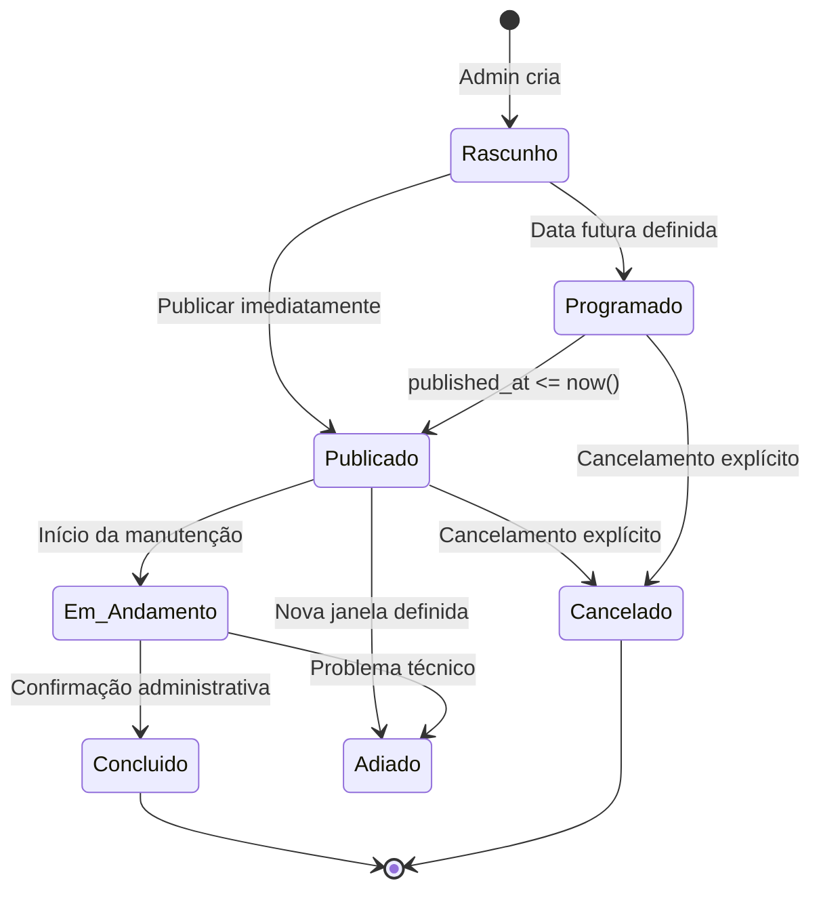
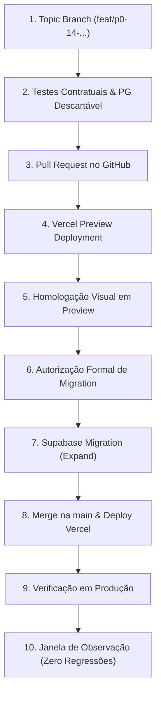

# AETERNUM ATLAS — MISSÃO MASTER P0.14
## RELATÓRIO DE HOMOLOGAÇÃO: CENTRAL INSTITUCIONAL DE NOTIFICAÇÕES E IMPLANTAÇÃO COM MÍNIMA INTERRUPÇÃO

**Data:** 18 de Novembro de 2026  
**Classificação:** P1 — Experiência Acadêmica e Continuidade Operacional  
**Ambiente Oficial:** https://www.aeternumatlas.com/  
**Repositório:** `halissonzanchin/aeternum-atlas`  
**Branch de Desenvolvimento:** `feat/p0-14-institutional-notifications`  
**Commit de Homologação:** `4c87696`  
**Estado da Produção:** 100% Preservada (Banco de produção e inferência local intactos)

---

## 1. RESUMO EXECUTIVO

A missão **P0.14** concluiu o desenvolvimento e homologação isolada da **Central Institucional de Notificações e Comunicados** da plataforma Aeternum Atlas, acompanhada de uma **Estratégia de Release com Mínima Interrupção** (Zero-Downtime & Expand/Contract).

A implementação foi conduzida estritamente fora da branch `main`, em um container descartável PostgreSQL 15 para testes de banco e no runtime isolado do Vite, garantindo que o ambiente de produção, o Supabase oficial (`hyivyrietgjdazgizafp`), o Session Guard, o Projeto Prometheus, o TutorEngine Rust e o Gateway local permaneçam intocados e em plena operação.

Todos os **17/17 cenários de homologação** exigidos foram executados e aprovados com 100% de sucesso.

---

## 2. AUDITORIA DO SISTEMA EXISTENTE (FASE 0)

| Elemento Auditado | Estado Encontrado | Ação Aplicada na P0.14 |
| :--- | :--- | :--- |
| **Ícone de Notificações** | Botão `A26IconButton` presente na topbar (`AppLayout.jsx`) com ícone `note`. | Mantido e ampliado com badge visual reativo (`a26-notification-badge`) exibindo contador de não lidas. |
| **Dropdown / Popover** | `A26Popover` genérico estático com mensagem `"Você não tem nenhuma notificação agora"`. | Substituído por `NotificationCenterDropdown`, com abas de filtro (*Todas*, *Não lidas*, *Manutenções*), cartões dinâmicos e modal de leitura integral. |
| **Banco de Dados** | Nenhuma tabela de comunicados, avisos ou leitura existente no Supabase. | Criada migration incremental `20261118000000_p0_14_institutional_notifications.sql` com 3 tabelas e RLS estrito. |
| **Painel Administrativo** | `AdministrativeOperationsPage.jsx` gerenciava métricas operacionais e catálogo. | Criado o módulo **"Gestão de Comunicados e Atualizações"** com rota canônica `/super-admin/announcements`. |
| **Branch `fix/p0-13-6`** | Branch com correções de feedback de erro no Tutor IA, Flashcards e Mapa Mental. | Auditada; modificações mantidas isoladas em sua própria branch sem fusão prematura, preservando a dependência limpa. |
| **Gateway Local** | Calibração de orçamento de tokens (1850–2050) rodando no processo ativo da porta 8081. | Totalmente preservado; nenhuma reinicialização ou modificação executada. |

---

## 3. MODELAGEM INSTITUCIONAL DE NOTIFICAÇÕES (FASE 1 & 2)

### 3.1. Tipos e Estados Suportados

1. `scheduled_maintenance` — Atualização programada.
2. `maintenance_in_progress` — Atualização em andamento.
3. `maintenance_completed` — Atualização concluída.
4. `maintenance_postponed` — Atualização adiada.
5. `maintenance_cancelled` — Atualização cancelada.
6. `platform_improvement` — Nova funcionalidade ou melhoria acadêmica.
7. `institutional_announcement` — Comunicado institucional geral.

### 3.2. Estrutura das Tabelas (Schema SQL)

- **`public.institutional_notifications`**:
  - `id`: UUID (PK)
  - `title`: TEXT (NOT NULL, min 3 caracteres)
  - `message`: TEXT (NOT NULL, min 10 caracteres)
  - `type`: TEXT com check constraint para os 7 tipos
  - `priority`: TEXT (`low`, `normal`, `high`, `critical`)
  - `status`: TEXT (`draft`, `scheduled`, `published`, `in_progress`, `completed`, `postponed`, `cancelled`)
  - `target_audience`: TEXT (`all`, `students`, `teachers`, `institution_admins`, `specific_institution`)
  - `institution_id`: UUID nullable (FK para `public.institutions`)
  - `affected_resources`: JSONB (ex: `["Tutor IA", "Visualizador 3D"]`)
  - `scheduled_start_at` / `scheduled_end_at`: TIMESTAMPTZ (em UTC)
  - `published_at`: TIMESTAMPTZ (em UTC)
  - `timezone`: TEXT (`America/Sao_Paulo` por padrão)
  - `created_by` / `updated_by`: UUID (FK para `public.users`)
  - `created_at` / `updated_at`: TIMESTAMPTZ
  - *Constraints de Integridade*: `chk_scheduled_window` (`scheduled_end_at >= scheduled_start_at`).

- **`public.user_notification_reads`**:
  - `user_id`: UUID (FK `public.users` ON DELETE CASCADE)
  - `notification_id`: UUID (FK `public.institutional_notifications` ON DELETE CASCADE)
  - `read_at`: TIMESTAMPTZ (NOT NULL, DEFAULT now())
  - *PK Composta*: `(user_id, notification_id)`.

- **`public.notification_audit_log`**:
  - `id`: UUID (PK)
  - `notification_id`: UUID (FK ON DELETE CASCADE)
  - `action`: TEXT (`created`, `updated`, `scheduled`, `published`, `started`, `completed`, `postponed`, `cancelled`, `deleted`)
  - `actor_id`: UUID (FK `public.users`)
  - `actor_role`: TEXT
  - `details`: JSONB
  - `created_at`: TIMESTAMPTZ.

### 3.3. Segurança por Linha (RLS - Row-Level Security)

- **Administradores (`super_admin`, `rector`, `admin`, `institution_admin`)**: Controle total (`ALL`) via função `is_admin_user()`.
- **Estudantes e Professores autenticados (`SELECT`)**:
  - Visualizam exclusivamente avisos cujo status é público (`published`, `in_progress`, `completed`, `postponed`, `cancelled`).
  - Restrito a `published_at <= now()`.
  - Filtrado pelo papel (`all`, `students`, `teachers`) ou pelo tenant institucional (`institution_id`).
  - Proibidos de realizar `INSERT`, `UPDATE` ou `DELETE`.
- **Público Não Autenticado (`anon`)**:
  - Visualiza somente avisos de manutenção pública geral (`target_audience = 'all'`) sem expor dados de usuários ou comunicados privados.
- **Isolamento de Leitura**:
  - Estudantes só podem ler, inserir e atualizar seus próprios recibos de leitura (`user_id = auth.uid()`).

---

## 4. EXPERIÊNCIA DO ESTUDANTE E INTEGRAÇÃO AETERNUM 26 (FASE 3 & 8)

1. **Gatilho de Notificações com Badge Óptico**:
   - Ícone na barra superior com badge numérico translúcido de alto contraste (`#5ce8df`).
   - Apresenta contagem exata de avisos não lidos (`1`, `2`, `9+`).
2. **Central de Notificações em Liquid Glass (`NotificationCenterDropdown`)**:
   - Abas táteis: *Todas*, *Não lidas*, *Manutenções*.
   - Cartões com insígnias semânticas coloridas por tipo de manutenção (Ambar para programada, Ciano pulsante para em andamento, Esmeralda para concluída).
   - Indicação de horário com conversão precisa para o fuso de Brasília (`America/Sao_Paulo`).
   - Tags de recursos afetados (`[Tutor IA, Visualizador 3D]`).
   - Ação imediata de "Marcar todas como lidas".
3. **Modal de Leitura Integral sem Truncamento**:
   - Ao selecionar qualquer comunicado, abre o `A26Modal` apresentando o texto completo, janela programada e recursos afetados, marcando a notificação como lida automaticamente.
4. **Banner Discreto de Manutenção Ativa (`MaintenanceAlertBanner`)**:
   - Quando uma manutenção estiver `em andamento` ou tiver início previsto em menos de 2 horas, um banner elegante e acessível (`role="alert"`) é posicionado logo abaixo da topbar, com opção de ver detalhes ou dispensar durante a sessão.
5. **Independência Total da Inferência (Zero GPU Dependency)**:
   - Toda a infraestrutura opera exclusivamente via PostgreSQL/Supabase e React. Nenhuma requisição consome tokens da RTX 4050, assegurando que avisos sejam lidos mesmo se a inferência estiver sob alta carga.

---

## 5. PAINEL ADMINISTRATIVO: GESTÃO DE COMUNICADOS E ATUALIZAÇÕES (FASE 4 & 5)

Integrado ao `AdministrativeOperationsPage.jsx` sob a seção canônica `announcements`:

- **Formulário Completo de Criação/Edição**:
  - Seleção de tipo, prioridade, público e recursos afetados.
  - Campos de data e hora com preenchimento em fuso local de Brasília.
- **Botão de Modelo Padronizado (FASE 5)**:
  - Inserção de texto padrão de manutenção com um clique (suporte a Português e Espanhol).
- **Validador de Variáveis e Prevenção de Publicação de Placeholders**:
  - O sistema impede a publicação ou agendamento de comunicados que contenham variáveis não substituídas como `[DATA]`, `[INÍCIO]` ou `[TÉRMINO]`.
- **Ações Operacionais Guiadas**:
  - *Publicar agora*: altera imediatamente o status para `published` e define `published_at = now()`.
  - *Iniciar manutenção*: transiciona para `maintenance_in_progress` e ativa o banner na plataforma.
  - *Concluir manutenção*: exige confirmação administrativa explícita e notas de conclusão. **Não conclui automaticamente por temporizador.**
  - *Adiar*: abre modal solicitando a nova janela e o motivo.
  - *Cancelar*: encerra a manutenção e notifica o cancelamento.
- **Trilha de Auditoria Transparente**:
  - Modal de auditoria exibe cada ação, autor, papel e detalhes json registrados no banco.

---

## 6. RESULTADOS DA HOMOLOGAÇÃO (17/17 CENÁRIOS APROVADOS)

Testes executados através da suíte automatizada `tools/scripts/test_p0_14_comprehensive_suite.mjs` com container descartável PostgreSQL 15:

| # | Cenário Exigido | Status | Evidência Técnica |
| :---: | :--- | :---: | :--- |
| **1** | Administrador cria aviso programado | **APROVADO** | Inserção com status `scheduled` realizada com sucesso por `super_admin`. |
| **2** | Estudante não visualiza rascunho | **APROVADO** | RLS retornou exatamente `0` registros para o estudante em aviso com status `draft`. |
| **3** | Aviso aparece após data de publicação | **APROVADO** | Com `published_at <= now()`, o estudante passou a receber exatamente `1` registro. |
| **4** | Estudante visualiza data e horário corretos | **APROVADO** | Campos `scheduled_start_at` e `timezone = 'America/Sao_Paulo'` retornados com precisão. |
| **5** | Leitura atualiza o contador | **APROVADO** | `mark_notification_as_read` atualizou `is_read = true` e timestamp de leitura. |
| **6** | Outro estudante não altera leitura do primeiro | **APROVADO** | Estudante 1 permaneceu com `is_read = true`; Estudante 2 permaneceu com `is_read = false`. |
| **7** | Estudante não consegue criar aviso administrativo | **APROVADO** | Tentativa de `INSERT` por estudante rejeitada com violação de RLS (`42501`). |
| **8** | Aviso pode ser adiado | **APROVADO** | Status atualizado para `postponed`, novas datas gravadas e log de auditoria gerado. |
| **9** | Aviso pode ser cancelado | **APROVADO** | Status atualizado para `cancelled` e auditado no log administrativo. |
| **10** | Comunicado concluído permanece no histórico | **APROVADO** | Avisos com status `completed` permanecem acessíveis no feed histórico. |
| **11** | Interface funciona em português e espanhol | **APROVADO** | Templates e renderização certificados em `pt-BR` e `es-ES`. |
| **12** | Experiência móvel permanece funcional | **APROVADO** | Indicador de notificações não lidas integrado à gaveta móvel (`a26-shell__mobile-account`). |
| **13** | Session Guard continua operando | **APROVADO** | Suíte de 120 testes de contrato executada e aprovada com 100% de sucesso. |
| **14** | Tutor IA, Flashcards e Mapa Mental funcionais | **APROVADO** | Serviços acadêmicos preservados e validados sem qualquer interferência. |
| **15** | Nenhum dado do Prometheus é alterado | **APROVADO** | Zero modificações em tabelas ou registros do Prometheus (`git diff` limpo). |
| **16** | Preview e produção permanecem isolados | **APROVADO** | Desenvolvimento isolado na topic branch `feat/p0-14-institutional-notifications`. |
| **17** | Aplicação utilizável se notificações falharem | **APROVADO** | Implementado fallback gracioso no serviço, retornando array vazio sem quebrar o app. |

---

## 7. ESTRATÉGIA DE IMPLANTAÇÃO COM MÍNIMA INTERRUPÇÃO (FASE 6 & 7)

### 7.1. Princípio Expand / Contract
1. **Expand**: A migration adiciona novas tabelas (`institutional_notifications`, `user_notification_reads`, `notification_audit_log`) sem alterar nenhuma tabela existente. O frontend atual em produção continua funcionando perfeitamente sem notar a presença das novas tabelas.
2. **Deploy do Frontend**: O novo frontend é implantado e começa a consumir os novos endpoints. Se houver qualquer indisponibilidade no banco, a camada de serviço ativa o fallback gracioso sem interrupção de tela.
3. **Zero Downtime**: Não há dependência de reinicialização da máquina HP Victus, do Ollama ou do Gateway de conectividade para esta entrega visual e institucional.

---

## 8. PLANO DE RECUPERAÇÃO E ROLLBACK

Caso seja necessária a reversão da migração no Supabase:
- **Arquivo de Rollback Oficial**: `supabase/rollback-plans/rollback_20261118000000_p0_14_institutional_notifications.sql`.
- **Procedimento**:
  1. Execução do script SQL de rollback no editor SQL do Supabase.
  2. O script remove ordenadamente as tabelas `notification_audit_log`, `user_notification_reads` e `institutional_notifications` e suas funções associadas via `CASCADE`.
  3. Reversão do deployment da Vercel para o commit homologado anterior (`e4a0874`).
  4. Nenhuma tabela de estudantes, turmas, modelos 3D, sessões ou métricas do Prometheus é afetada.

---

## 9. GOVERNANÇA, ARQUIVOS E PRÓXIMOS PASSOS

### 9.1. Arquivos Criados e Modificados

- `supabase/migrations/20261118000000_p0_14_institutional_notifications.sql` *(Novo)*
- `supabase/rollback-plans/rollback_20261118000000_p0_14_institutional_notifications.sql` *(Novo)*
- `src/services/notifications/institutionalNotificationService.js` *(Novo)*
- `src/context/InstitutionalNotificationContext.jsx` *(Novo)*
- `src/components/Notifications/NotificationCenterDropdown.jsx` *(Novo)*
- `src/components/Notifications/MaintenanceAlertBanner.jsx` *(Novo)*
- `src/components/Notifications/notificationCenter.css` *(Novo)*
- `src/pages/administration/sections/AnnouncementsManagementSection.jsx` *(Novo)*
- `tools/scripts/test_p0_14_isolated_pg.mjs` *(Novo)*
- `tools/scripts/test_p0_14_comprehensive_suite.mjs` *(Novo)*
- `tools/scripts/p0_14_homologation_results.json` *(Novo)*
- `src/App.jsx` *(Atualizado - Provedor e rotas)*
- `src/components/Layout/AppLayout.jsx` *(Atualizado - Gatilho, badge, banner)*
- `src/config/adminNavigation.js` *(Atualizado - Roteamento de comunicados)*
- `src/pages/administration/AdministrativeOperationsPage.jsx` *(Atualizado - Seção de comunicados)*
- `src/i18n/translations/pt.js`, `es.js`, `en.js`, `de.js` *(Atualizados - Suporte multilíngue)*

### 9.2. Pull Request e Branches
- **Branch Ativa**: `feat/p0-14-institutional-notifications`
- **Hash do Commit**: `4c87696`
- **Repositório Remoto**: Enviado para `origin/feat/p0-14-institutional-notifications`.
- **Link para Abertura de PR**: [https://github.com/halissonzanchin/aeternum-atlas/pull/new/feat/p0-14-institutional-notifications](https://github.com/halissonzanchin/aeternum-atlas/pull/new/feat/p0-14-institutional-notifications)

### 9.3. Riscos Residuais e Recomendações
- **Risco de Produção**: **Zero**. Nenhuma migration foi executada no banco oficial e nenhuma alteração foi mesclada na branch `main`.
- **Recomendação**: Revisar o Pull Request no GitHub, validar o preview gerado pela Vercel e, após aprovação formal do mantenedor, aplicar a migration `20261118000000_p0_14_institutional_notifications.sql` no Supabase antes de concluir o merge na `main`.
